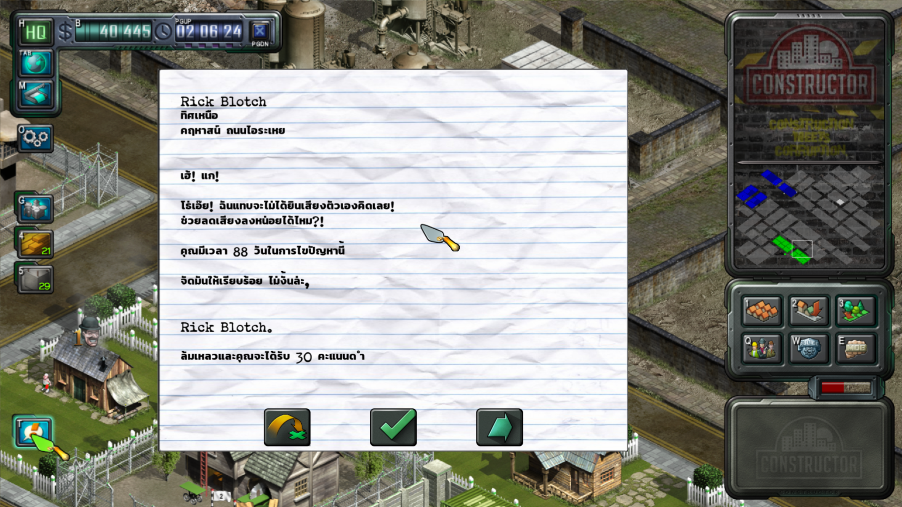
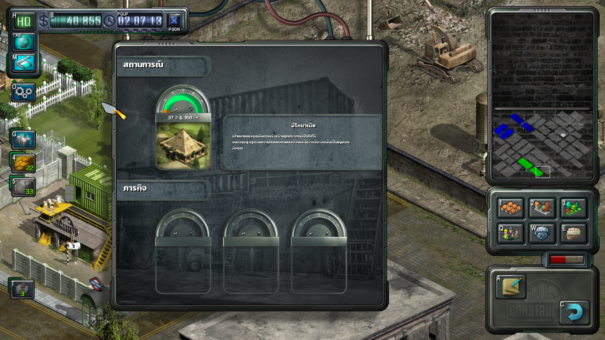
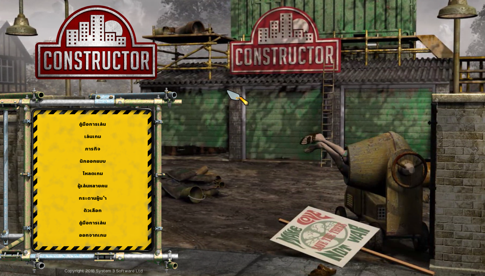
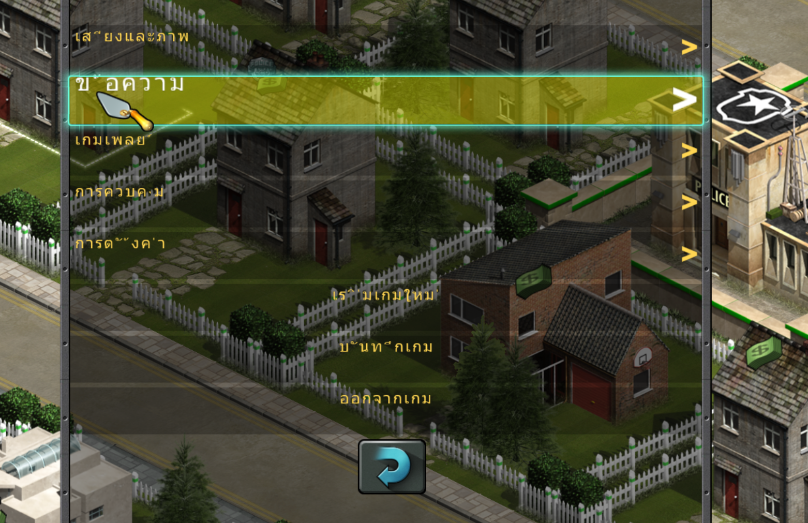

# Constructor HD (2017) - ม็อดภาษาไทยสมบูรณ์ (Thai Language Mod)



ม็อดแปลภาษาไทยสมบูรณ์แบบสำหรับเกม **Constructor HD (2017 Remaster)** บน Steam (App ID: 579020) มาพร้อมกับระบบ **DirectX Thai Vowel & Tone Shaping** แก้ปัญหาสระและวรรณยุกต์ลอย/แยกช่องไฟได้อย่างสมบูรณ์แบบ 100% พร้อมฟอนต์ไทยตัวหนาคม **Kanit Bold (คณิต)** สไตล์เกมมิ่งอ่านง่ายสบายตา

---

## 📸 ภาพตัวอย่างในเกม (Screenshots)

| หน้าเมนูหลักและการตั้งค่า | หน้าตัวเลือกและคำสั่ง |
| :---: | :---: |
|  |  |
| **บทสนทนาและคำอธิบายเควส** | **หน้าต่างควบคุมและ UI ในเกม** |
|  |  |

---

## ✨ ฟีเจอร์เด่นของม็อด (Features)

* **แปลภาษาไทยครบ 100%**: แปลครบทุกบรรทัด (รวม 7,063 บรรทัด / 5,710 ข้อความที่แสดงผล) ทั้งเมนูหลัก, แถบควบคุม, เควส, คำแนะนำ, อธิบายตัวละคร และไดอะล็อกทุกตัวในเกม
* **ฟอนต์เกมมิ่งตัวหนาคม (Kanit Bold)**: บรรจุฟอนต์ไทยคุณภาพสูงตัวหนาคมลงในคลังฟอนต์ทั้ง 11 ชุดของเอนจิน คมชัดทุกระดับความละเอียด
* **ระบบจัดสระอัตโนมัติ (Direct3D 9 Proxy Shaping - `d3d9.dll`)**:
  * แก้ไขข้อจำกัดดั้งเดิมของเอนจินเกมปี 1997 ที่ไม่มีระบบ Unicode Shaping
  * ดึงสระบน สระล่าง และวรรณยุกต์ กลับมาประกบเหนือ/ใต้พยัญชนะอย่างแม่นยำ ไม่เว้นวรรคเพี้ยน
  * **รองรับการซ้อน 2 ชั้น (Tone Mark Stacking)**: คำที่มีสระบนและวรรณยุกต์ (เช่น *เริ่ม, ขี้, กิ่*) ตัววรรณยุกต์จะลอยขึ้นไปซ้อนเหนือสระบนโดยอัตโนมัติ
  * **หลบหางพยัญชนะตัวสูง**: ปรับเยื้องสระหลบหางพยัญชนะ *ป, ฝ, ฟ* ไม่ให้ชนหาง
  * **วัดขนาดกึ่งกลางสมดุล (Zero Width Measurement)**: ปรับค่าความกว้างสระผสมเป็น 0 ทำให้ข้อความกึ่งกลางปุ่มและแถบเมนูตรงตำแหน่ง ไม่เบี้ยว
* **ชุดติดตั้งขนาดจิ๋ว (Mini Patcher)**:
  * ขนาดไฟล์แพ็กเกจ **เพียง ~21.8 MB**
  * ขับเคลื่อนด้วย **`patcher.exe`** ที่เขียนด้วยภาษา C++ แบบ Native ทำงานได้ทันที **ไม่ต้องติดตั้ง Python หรือโปรแกรมเสริมใดๆ**

---

## 🛠️ วิธีการติดตั้ง (Installation)

### ขั้นตอนง่ายๆ ใน 1 นาที:
1. ดาวน์โหลดหรือคัดลอกโฟลเดอร์ **`Constructor_Thai_Mod_Mini`** ไปวางไว้ในโฟลเดอร์ตัวเกม Constructor ของคุณ:
   * ตัวอย่าง: `C:\Program Files (x86)\Steam\steamapps\common\Constructor\`
   * หรือ: `D:\SteamLibrary\steamapps\common\Constructor\`
2. เข้าไปในโฟลเดอร์ `Constructor_Thai_Mod_Mini` แล้วดับเบิ้ลคลิกที่ไฟล์:
   * 👉 **`ติดตั้ง_MOD_ภาษาไทย_Mini.bat`**
3. โปรแกรมจะสำรองไฟล์เดิมและแพตช์ไฟล์ภาษาไทยลงในเกมให้อัตโนมัติใน **1 วินาที**
4. เปิดเล่นเกมผ่าน **Steam** ได้ทันที!

---

## 🔄 วิธีการถอนการติดตั้ง (Uninstall)

หากต้องการกลับไปใช้ภาษาอังกฤษเดิม:
* ดับเบิ้ลคลิกที่ไฟล์ **`ถอนการติดตั้ง_MOD_ภาษาไทย.bat`** ตัวเกมจะคืนค่ากลับเป็นภาษาอังกฤษเดิม 100% ทันที
* หรือคลิกขวาที่เกมใน Steam -> **Properties** -> **Installed Files** -> กด **Verify integrity of game files**

---

## 📁 โครงสร้างไฟล์ในชุดม็อด

```text
Constructor_Thai_Mod_Mini/
├── patcher.exe                  # โปรแกรม C++ สำหรับแพตช์ข้อความลง DATA.FIL
├── TEXT.ENG.thai                # ข้อมูลแปลภาษาไทยเข้ารหัสพร้อมใช้ (832 KB)
├── d3d9.dll                     # DirectX Proxy ตัวขับเคลื่อนการจัดสระไทย
├── ติดตั้ง_MOD_ภาษาไทย_Mini.bat    # ตัวติดตั้งม็อดอัตโนมัติในคลิกเดียว
├── ถอนการติดตั้ง_MOD_ภาษาไทย.bat   # ตัวถอนการติดตั้ง คืนค่าเป็นภาษาอังกฤษ
├── คู่มือ_วิธีใช้งาน.txt          # คู่มือการใช้งานภาษาไทย
├── README.md                    # เอกสารแนะนำโครงการและภาพตัวอย่าง
├── SS/                          # โฟลเดอร์รวมภาพตัวอย่าง Screenshots ในเกม
└── Master/
    └── FONTS/DATA.FIL           # คลังฟอนต์ภาษาไทย Kanit Bold ทั้ง 11 ชุด
```

---

## 📜 ข้อแนะนำในการเล่น
* **แนะนำให้เริ่มเล่นเกมใหม่ (New Game)**: เพื่อให้ระบบจำลองและภาษาไทยทำงานร่วมกันได้อย่างสมบูรณ์แบบที่สุด
* สำหรับเซฟเกมเก่าที่สร้างไว้นานแล้ว (ข้ามเวอร์ชัน) หากโหลดแล้วพบปัญหายูนิตตาย เป็นบั๊ก State Desync ประจำตัวของเอนจิน Constructor HD ดั้งเดิม แนะนำให้เริ่มเซฟใหม่เพื่อประสบการณ์การเล่นที่ดีที่สุดครับ

---

*ขอบคุณผู้เล่นเกม Constructor HD ทุกท่านที่ให้ความสนใจ!*
